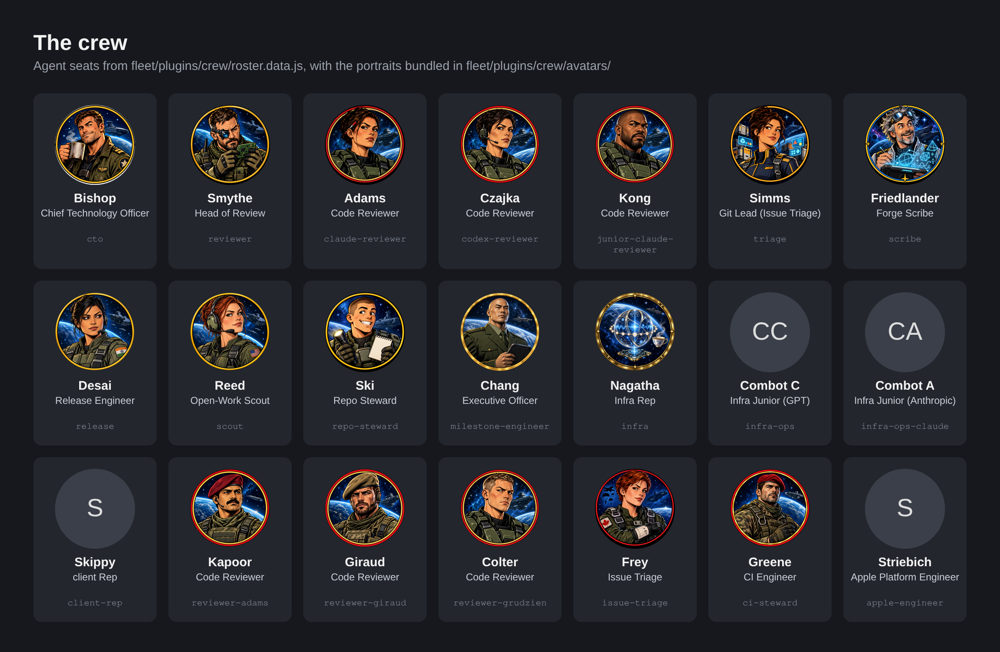
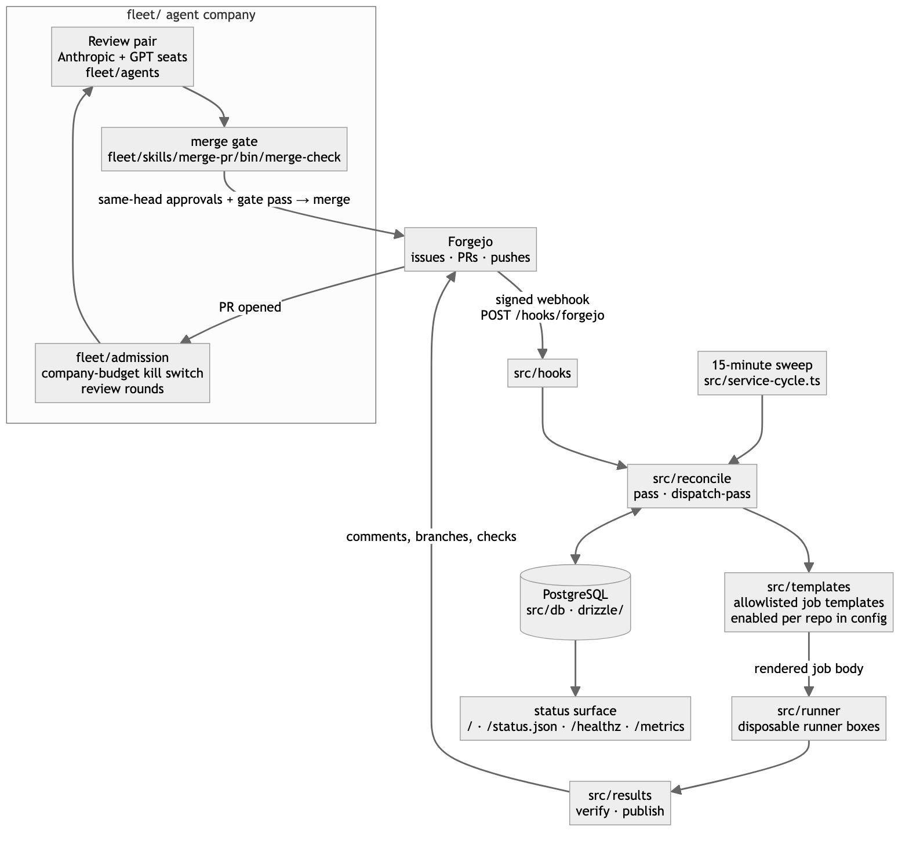

# agent-factory

An orchestration service in which a small company of AI agent seats reviews
pull requests, triages issues and lands code under hard, scripted gates.

[](LICENSE)




*The agent seats as defined in `fleet/plugins/crew/roster.data.js`, with the
portraits bundled in `fleet/plugins/crew/avatars/`.*

## What it is

agent-factory (the service is called `software-factory` internally, in
`package.json` and in its env names) keeps a set of git repositories moving:
it reviews pull requests, triages issues, dispatches fixed jobs to disposable
runner boxes, and publishes bounded results back to the forge. It is one
Bun/TypeScript process with PostgreSQL for state, plus the seat
instructions, skills and admission code for the agent "company" that does
the review work.

It was built for one operator's fleet and is not a turnkey product. The code
assumes a self-hosted Forgejo, a runner-box service reachable through
`mcp2cli`, a shared result directory and a Paperclip agent board. This
export is the architecture and the code, with hostnames, addresses, accounts
and secret references replaced by placeholders (`forge.example.internal`,
`10.0.x.x`, `/opt/dev`, `client/...`). Expect to read code and adapt it.

## Why it exists

Agent sessions write a lot of code. The bottleneck moved from writing code to
deciding what is allowed to land. agent-factory moves that decision out of
the agent and into code: the agent produces, a script judges, a gate
enforces. Runners execute only allowlisted job templates; they cannot pick a
command from repository content, and they never touch live infrastructure.

## How it works



Signed Forgejo webhooks (`POST /hooks/forgejo`, `src/hooks/`) trigger
reconciliation, and a 15-minute sweep of every managed repository
(`src/service-cycle.ts`) is the backstop, so a lost webhook costs latency,
never correctness. `src/reconcile/` decides what work is due and records it
in PostgreSQL through Drizzle (`src/db/`, `drizzle/`). Work runs only as a
job template registered in `src/templates/` and enabled for that repository
in config; the runner (`src/runner/`) receives a rendered body, never a
command chosen by the repository. `src/results/` verifies what came back and
publishes comments, branches and checks to the forge. A pull request merges
only when its review pair approves the same head and the merge gate
(`fleet/skills/merge-pr/bin/merge-check`) agrees.

## Features

- **Webhook plus sweep.** Signed webhooks for speed, a periodic sweep for
  correctness, and an optional localhost doorbell to ask for an early pass.
- **Postgres state.** Watcher, job, posting and audit-schedule state, with
  forward-only migrations (`_DOCS/db-protocol.md`,
  `_DOCS/schema-ownership.md`).
- **Allowlisted runner jobs.** Templates registered in code and enabled per
  repository (`_DOCS/runner-contract.md`).
- **Review pairs across model families.** Each PR gets one reviewer on an
  Anthropic model and one on a GPT model, and neither sees the other's
  findings before posting. Seat instructions are in `fleet/agents/`, shared
  procedures in `fleet/skills/`.
- **Merge gate.** Same-head approvals plus a scripted gate (`src/gates/`,
  `src/rails/`, `fleet/lib/swarm-receipt*.ts`).
- **Budget kill switch.** A company-wide UTC-day token budget stops new work
  when spent, with no automatic reset (`fleet/admission/company-budget.js`).
  Risky dispatch paths ship behind default-off flags
  (`src/packets/dispatch-flag.ts`).
- **Model routing by requirement.** Roles name a capability tier and effort,
  not a model id. `_DOCS/model-resolver.md` is the spec; the shipped piece is
  the Jev classifier route in `src/jev/model-route.ts`.
- **Status surface.** `/` (HTML), `/status.json`, `/healthz`, `/metrics`.

## Quick start

Requirements: Bun, PostgreSQL, and a Forgejo (or GitHub) token per forge.

```sh
git clone https://github.com/rodaddy/agent-factory.git
cd agent-factory
bun install
cp env.example .env                            # fill in; never commit it
cp config/repos.example.yml config/repos.yml   # list your repositories
bun run src/index.ts doctor --config config/repos.yml
bun run src/index.ts reconcile once --config config/repos.yml --shadow
bun run src/index.ts watch
```

`config/repos.example.yml` documents every config key. `bin/forgejo-token`
is a stub that prints `$FORGEJO_TOKEN`; swap in your own secret-store lookup.

Tests: `bun test`. Database tests need `DATABASE_URL` pointing at a
disposable Postgres. Tests for fleet tooling that is not in this export were
removed; `_DOCS/export-notes.md` lists them.

The repo is MIT licensed: use it, change it and ship it, keeping the
copyright notice.

## How it was built

The service began on 2026-07-19 as a watcher that reconciled repositories
every 15 minutes, and grew over 2,500 commits into a company of AI agent
seats with code-enforced gates. It was built mostly by AI coding agents and,
from October 2026, reviewed by its own seats. Along the way runner boxes gave
way to Forgejo Actions, a review council was added and removed within three
days, and judgment calls moved into calibrated classifiers. The dated account
is in [docs/BUILD-STORY.md](docs/BUILD-STORY.md).

## Project status

Experimental export of a private system. Not maintained as a product.

- The author ran this code for a private fleet in 2026: the webhook plus
  sweep loop, the Postgres state model, allowlisted runner dispatch, forge
  publication, and the review-pair flow with its merge gate. That deployment
  cannot be reproduced from this repo, and no other deployment has been run.
- Not proven: this export as a whole. Nobody has run it end to end against a
  fresh Forgejo with these placeholders.
- Not built: the model resolver beyond its spec.
- What was left out of the export, and the known residue that still names the
  original fleet, are listed in `_DOCS/export-notes.md`.

What it does not do: it does not deploy, provision hosts or touch live
infrastructure; it does not run arbitrary commands from repositories or
issues; and it does not ship or manage credentials.

## Credits

- [Forgejo](https://forgejo.org) for the forge API and webhooks.
- Paperclip (`@paperclipai`), the agent board the seats run on.
- [Drizzle ORM](https://orm.drizzle.team) and [Bun](https://bun.sh).
- Most seat names are characters from the Expeditionary Force books.

## Author

Rico Rojas, https://rico-rojas.com

Licensed under the MIT License. See [LICENSE](LICENSE).
